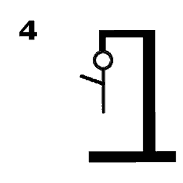

# Galgje – Git Collaboration

**Team:** <Teamnaam>  
**Spelvolgorde & contact:**
1. Hugo
2. Nikita

---

## Woordraster
<!-- Pas het aantal kolommen aan aan de woordlengte -->
| . | C | . | . | . | . | . | . | E | . | . |
| - | - | - | - | - | - | - | - | - | - | - |
| 1 | 2 | 3 | 4 | 5 | 6 | 7 | 8 | 9 | 10 | 11 |

## Status

---

## Beurtenlog
<!-- (Git-master vult hier reactie in: goed/fout + updates) -->
- Beurt1 : a (fout)
- Beurt2 : c (goed x1)
- Beurt3 : p (fout)
- Beurt4 : g (fout)
- buert5 : e (goed x1)
- beurt6